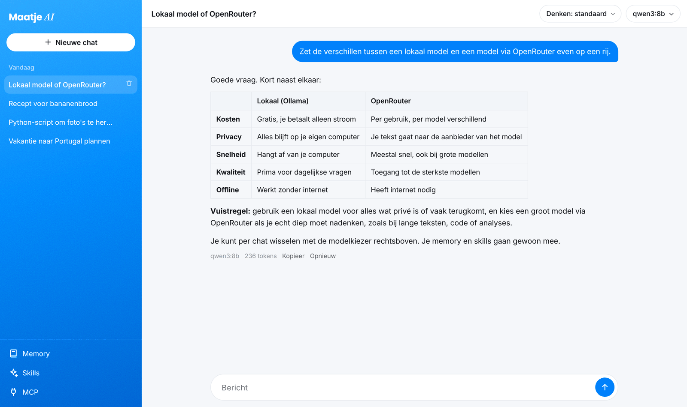

# Maatje AI

Een eigen AI-chat die je zelf host. Je kiest per gesprek elk model via OpenRouter, of een lokaal model op je eigen computer met Ollama. Het geheugen is van jou: gewone tekstbestanden op je eigen server, niet bij een AI-bedrijf.

Licht gehouden, zonder franje. Draait prima op een Raspberry Pi.



## Wat het kan

- **Elk model.** Alle modellen van OpenRouter (Claude, GPT, Gemini, Qwen en honderden andere), met favorieten en per model de denkstand ("effort").
- **Lokale modellen.** Ollama op je eigen computer, ook via Tailscale. Gratis, en je tekst blijft bij jou.
- **Zakelijk en privé.** Twee gescheiden werelden, elk met eigen chats en een eigen memory. Een privéchat ziet je zakelijke memory niet, en andersom.
- **Privé op slot.** Privé is versleuteld met een code die alleen jij kent. Er werken alleen lokale modellen, en de app vraagt eerst of iets in je privé-memory mag.
- **Memory.** Profiel, voorkeuren, mensen en bedrijven, projecten en onderwerpen, als markdown-bestanden met git-geschiedenis. Na elk gesprek werkt een model naar keuze ze bij. Wachtwoorden, keys en rekeningnummers komen er nooit in. Alles is te bekijken en aan te passen in de app.
- **Skills.** Vaste werkwijzen in hetzelfde formaat als die van Claude (een map met `SKILL.md`). Upload een `.zip`, `.skill` of `SKILL.md`, of schrijf er een in de app. Een model pakt een skill erbij als hij past, of je kiest er zelf een door je bericht met `/naam` te beginnen.
- **MCP.** Koppel andere apps als tools, zoals Supabase, zoeken op internet (Exa) of elke andere MCP-server met een https-adres. Inloggen via je browser of met een sleutel. Lezen gaat vanzelf; wil een model iets wijzigen, dan vraagt de app eerst toestemming.
- **Telefoon.** Werkt als app op je beginscherm. Antwoorden lopen door als je telefoon in slaap valt.
- **Wachtwoord.** Standaard aan.

De app is in het Nederlands.

## Snel starten: Docker Compose (4 commando's)

Werkt op Windows, macOS en Linux. Nodig: Git en Docker Desktop, of Docker Engine met Compose v2. Geen Node.js nodig.

```bash
git clone https://github.com/GEBRUIKERSNAAM/maatje-ai.git
cd maatje-ai
cp .env.example .env
docker compose up -d --build
```

Plak dit in je terminal. Daarna:

- Open http://localhost:3080 zodra `docker compose ps` de container als `healthy` laat zien.
- **Eerste keer inloggen:** het wachtwoord staat in `docker compose logs maatje-ai`. Zelf een wachtwoord kiezen kan met `APP_PASSWORD` in `.env`.
- **OpenRouter-key:** plak je key in de app, bij de modelkiezer rechtsboven. Of zet hem als `OPENROUTER_API_KEY` in `.env`. Gebruik je alleen lokale modellen, dan heb je geen key nodig.
- **Poort 3080 al bezet?** Zet `APP_PORT=7001` (of een andere poort) in `.env` en draai `docker compose up -d` opnieuw.
- Alles luistert standaard alleen op `127.0.0.1`, dus alleen op die computer zelf.

Na een wijziging in `.env`: `docker compose up -d`.

### Op je telefoon en andere apparaten

De app luistert standaard alleen op de computer zelf. De veiligste manier om er van buitenaf bij te komen is [Tailscale](https://tailscale.com): dan kunnen alleen jouw eigen apparaten erbij.

```bash
sudo tailscale serve --bg --https=8443 http://127.0.0.1:3080
```

Daarna open je hem op `https://<naam-van-je-computer>.<jouw-tailnet>.ts.net:8443`. Gebruik geen Tailscale Funnel en zet geen poort open in je router: dan staat je chat, met je memory en je keys, op internet.

Gebruik je hem alleen via Tailscale, dan mag het wachtwoord uit met `AUTH=off` in `.env`.

### Lokale modellen (Ollama)

1. Installeer [Ollama](https://ollama.com) op de computer met de modellen en haal een model op, bijvoorbeeld `ollama pull qwen3:8b`.
2. Zet Ollama open voor je netwerk. In de Mac-app is dat Settings › "Expose Ollama to the network". Zonder de app zet je `OLLAMA_HOST=0.0.0.0` voordat Ollama start.
3. Zet in `.env` het adres van die computer: `LOCAL_BASE_URL=http://100.x.y.z:11434` (Tailscale-IP) of het adres op je thuisnetwerk.
4. `docker compose up -d`. De modellen staan dan in de modelkiezer onder "Lokaal".

Staat die computer uit, dan meldt de app dat netjes, en wacht het bijwerken van de memory tot hij er weer is.

## Instellingen (.env)

| Instelling | Wat het doet |
|---|---|
| `OPENROUTER_API_KEY` | Je key van OpenRouter. Kan ook in de app, bij de modelkiezer |
| `APP_PORT` | Poort op je computer, standaard 3080 |
| `APP_PASSWORD` | Je wachtwoord. Leeg = de app maakt er zelf een (zie de logs) |
| `AUTH` | `off` = geen wachtwoord. Alleen doen als de app niet vanaf internet of je thuisnetwerk bereikbaar is |
| `DEFAULT_MODEL` | Model voor een nieuwe chat. Leeg = het laatst gekozen model |
| `SYSTEM_PROMPT` | Vaste instructie die elk gesprek meekrijgt |
| `LOCAL_BASE_URL` | Adres van Ollama, bijv. `http://100.x.y.z:11434` |
| `LOCAL_NAME` | Hoe de app die computer noemt, bijv. `Mac` |
| `LOCAL_NUM_CTX` | Hoeveel tekst een lokaal model in één keer ziet (tokens), standaard 32768 |
| `MEMORY_MODEL` | Model dat de memory bijwerkt, bijv. `local/qwen3:8b`. Leeg = het model waarmee je het laatst chatte. Ook te wijzigen in de app |
| `PRIVATE_LOCK_MINUTES` | Na hoeveel minuten niks doen Privé weer op slot gaat, standaard 15 |

## Hoe het werkt

### Memory

Er zijn twee ruimtes, met elk dezelfde indeling: `data/memory` voor zakelijke chats (gewone bestanden) en `data/memory-private.vault` voor privéchats (versleuteld, zie [Privé](#privé)). Met de schakelaar bovenaan de zijbalk wissel je tussen Zakelijk en Privé; in privé is de zijbalk donker. Een chat ziet alleen de memory van zijn eigen ruimte, en de bijwerker schrijft alleen naar die ruimte. Een bestand verhuizen naar de andere ruimte kan in het memory-paneel.

Indeling van een ruimte:

```
profile.md        wie je bent
preferences.md    hoe het model zich moet gedragen
people/           één bestand per persoon of bedrijf
areas/            één bestand per project of lopende zaak
topics/           de rest, per onderwerp
```

Elk gesprek krijgt je profiel en voorkeuren mee, plus de bestanden die bij het gesprek passen (op naam en bijnamen). Modellen met tools kunnen zelf extra bestanden openen. Na elk antwoord kijkt het bijwerk-model of er iets blijvends is gezegd en past de bestanden aan. Elke wijziging komt in git, zodat je kunt terugzien wat er veranderde. Het bijwerken kun je in de app uitzetten.

Heb je al een geheugen in een andere AI, exporteer dat dan naar losse markdown-bestanden in deze indeling en zet ze in `data/memory`.

### Privé

De eerste keer dat je op Privé klikt, kies je een code. Daarmee wordt alles in Privé versleuteld (AES-256-GCM, met een sleutel uit je code via scrypt): je privéchats in de database en je privé-memory, inclusief de bestandsnamen en de geschiedenis. Wie je server, je `data`-map of een backup heeft, kan er zonder code niks mee.

- **Op slot.** Na 15 minuten niks doen in Privé, met de knop "Op slot zetten", en bij elke herstart van de server. De sleutel staat dan nergens meer. Elke browser opent Privé apart: open je het op je telefoon, dan blijft het op je laptop op slot.
- **Alleen lokale modellen.** In Privé kies je alleen uit de modellen op je eigen computer (Ollama), en MCP staat uit. Zo gaat er niks van je privégesprekken naar buiten.
- **Eerst vragen.** Na een privégesprek stelt de bijwerker voor wat er in je privé-memory kan. Jij vinkt aan wat mag en klikt op Opslaan. Zelf bewerken in het memory-paneel kan altijd.
- **Code wijzigen** kan onderaan het memory-paneel van Privé.
- **Code vergeten?** Dan is Privé niet terug te halen, door niemand. Je kunt Privé wel wissen en opnieuw beginnen ("Code vergeten?" op het slotscherm). Zakelijk blijft dan gewoon staan.

Verplaats je een bestand van zakelijk naar privé, dan haalt de app de oude versies ook uit de zakelijke geschiedenis.

Goed om te weten:

- Code wijzigen verandert de code waarmee de sleutel is afgesloten, niet de sleutel zelf. Denk je dat iemand je oude code kent én een oude backup heeft, gooi die backups dan weg.
- Had je Privé al in een eerdere versie, dan versleutelt de app dat zodra je een code instelt. Backups van daarvoor bevatten het nog onversleuteld.
- Wissen op een SD-kaart of SSD haalt oude bestanden niet altijd echt van de schijf. Wil je ook dat dichttimmeren, zet dan schijfversleuteling aan op je server.

### Skills

Staan in `data/skills/<naam>/SKILL.md`, eventueel met extra bestanden ernaast. Bovenaan elke `SKILL.md` staan een naam en een omschrijving:

```markdown
---
name: offerte-opvolgen
description: Hoe we een openstaande offerte opvolgen. Gebruik dit als iemand vraagt om een offerte na te bellen of te mailen.
---

# Offerte opvolgen
...
```

Modellen met tools zien de lijst met skills en lezen de juiste zelf. Lokale modellen zonder tools krijgen een skill mee als de naam in je bericht voorkomt. Typ `/` in het berichtvak om er zelf een te kiezen. Skills die scripts draaien of bestanden maken (Excel, PowerPoint) werken hier als tekst: Maatje AI voert geen code uit.

### MCP

Via **MCP** in de zijbalk voeg je servers toe:

- **Supabase**: je database bekijken en vragen erover beantwoorden. Standaard alleen lezen.
- **Op internet zoeken**: via Exa, werkt zonder account.
- **Andere MCP-server**: elk https-adres, met inloggen via je browser of met een sleutel.

Lezen gaat vanzelf. Tools die iets kunnen wijzigen vragen in de chat om toestemming: toestaan, altijd toestaan of weigeren. Per tool is dat later aan te passen.

## Veiligheid

- Alles wat gevoelig is staat in `.env` en `data/`: je keys, je gesprekken, je memory en de logins van MCP-servers. Deel die nooit en zet ze niet in git (ze staan in `.gitignore`).
- Laat het wachtwoord aan, tenzij alleen jouw eigen apparaten erbij kunnen (bijvoorbeeld via Tailscale).
- Na vijf foute wachtwoorden moet je een kwartier wachten. Voor de code van Privé geldt hetzelfde.
- Bewaar de code van Privé in je wachtwoordmanager. Er is geen herstel.
- Zet Supabase en andere databases bij voorkeur op alleen lezen. Heb je zowel een database als zoeken op internet aan staan en wil je extra voorzichtig zijn, zet dan bij Internet de tool `web_fetch_exa` op vragen (vinkje "zonder vragen" uit).

## Updaten en backup

```bash
git pull
docker compose up -d --build
```

Je gegevens staan in `data/`; neem die map mee in je backup. Stop de container even (`docker compose stop`) voor een backup van `data/chats/chats.db`. Wat in Privé staat, blijft ook in de backup versleuteld; zonder je code heb je er niks aan.

## Zonder Docker

Kan ook, met Node.js 22.13 of nieuwer en git:

```bash
npm ci --omit=dev
cp .env.example .env           # vul in
node --env-file=.env --disable-warning=ExperimentalWarning server/index.js
```

## Licentie

[AGPL-3.0-or-later](LICENSE). Je mag Maatje AI gebruiken, aanpassen en delen. Bied je een aangepaste versie aan anderen aan, ook als dienst via internet, dan moet je die aanpassingen onder dezelfde licentie openbaar maken.

De lettertypes Inter, Poppins en Fraunces vallen onder de SIL Open Font License.
